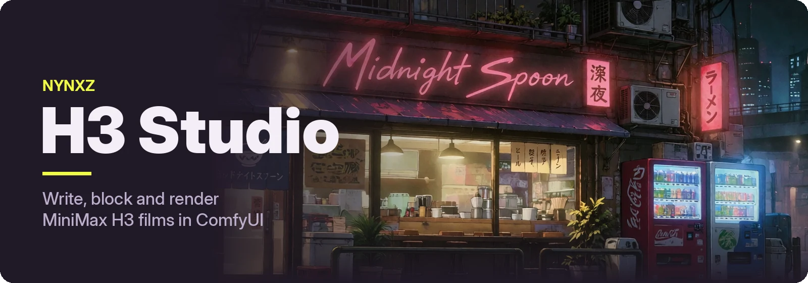
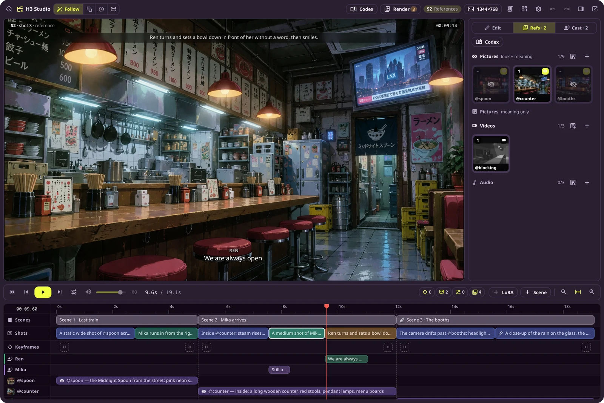
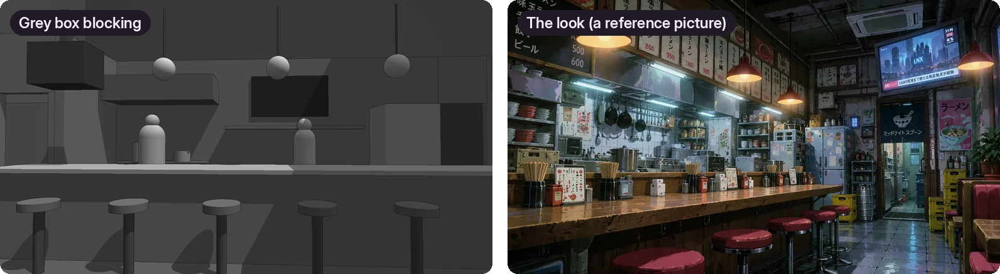
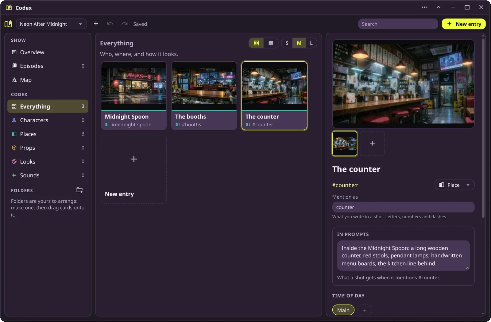

Make short films with [MiniMax H3](https://github.com/MiniMax-AI/MiniMax-H3) in ComfyUI. Write the
film as scenes, block it out in 3D, keep your characters and places in one place, and render the
whole thing in one queue.

## H3 Studio

One node holds the whole film. Each **scene** is one H3 generation (about 5–15 seconds); its
**shots** are the beats inside it. Mention a reference as `@counter` and the studio writes it into
H3's prompt for you; give a line to a character and they say it.



- Pictures, videos and audio as references, each used only in the scenes that need it
- Dialogue with a voice per character
- Scenes that flow into each other, carrying the last frames and sound across the cut
- Render the whole film, one scene, or only what changed — unchanged scenes reuse their last clip

→ [How H3 Studio works](docs/H3-STUDIO.md)

## Grey Box Studio

Block a scene before you spend a render on it: a set made of simple shapes, characters walking
between marks, and a camera for each shot. The grey video goes into H3 Studio as a **blocking**
reference, so H3 keeps the layout and camera move while the look comes from your other references.



→ [How Grey Box works](docs/GREYBOX.md)

## The Codex

Your show's bible: every character, place and prop once, with its pictures, a description, a voice
and LoRAs. In H3 Studio, the References tab's **Fill from Codex** button fills a film's `@references` from it by name.



## Install

```bash
cd ComfyUI/custom_nodes
git clone https://github.com/Nynxz/ComfyUI-NynxzH3Studio
cd ComfyUI-NynxzH3Studio
pnpm install && pnpm build
```

Then restart ComfyUI. You need ComfyUI 0.30.0 or newer and the H3 models. Optional:
[ZenKit](https://github.com/Nynxz/ZenKit) for pop-out windows, and
[ComfyUI-NynxzNodes](https://github.com/Nynxz/ComfyUI-NynxzNodes) for LoRA lanes. Saved
workflows from NynxzNodes or NynxzH3 load unchanged.

## More

- [H3 Studio](docs/H3-STUDIO.md) — the editor, references, continuations and rendering the film in a loop
- [Grey Box](docs/GREYBOX.md) — the editor, the file format, agent tools and the command line
- [Building blocks](docs/NODES.md) — the lower-level H3 nodes: conditioning, prompts, faster sampling, partial decoding
- [Writing scripts with an agent](skills/h3-studio/SKILL.md) — the script format an LLM can write and the studio can paste in

The art in these screenshots is from *Neon After Midnight*. The code is MIT licensed.
