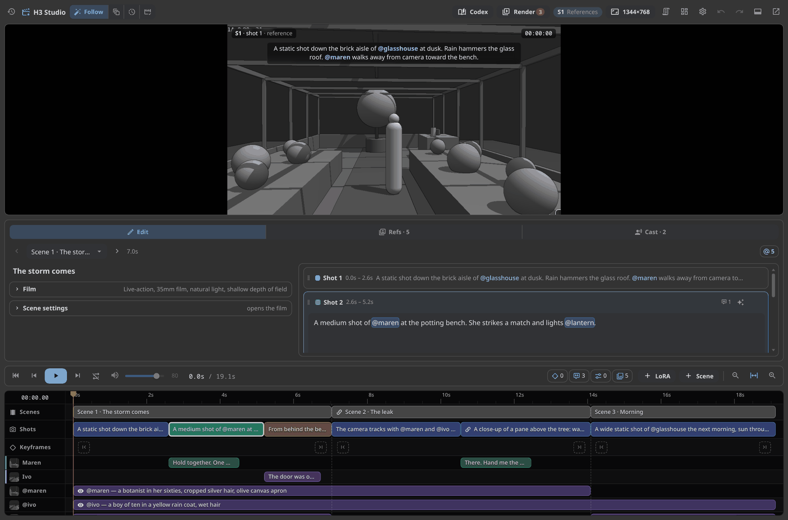
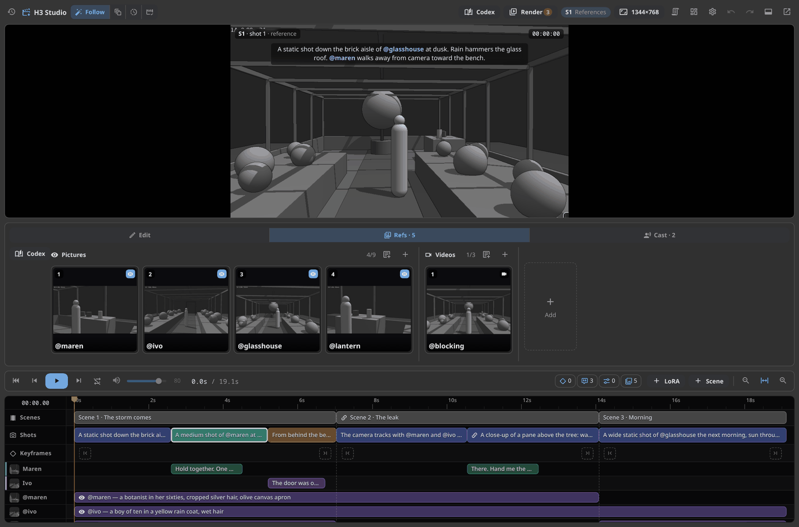
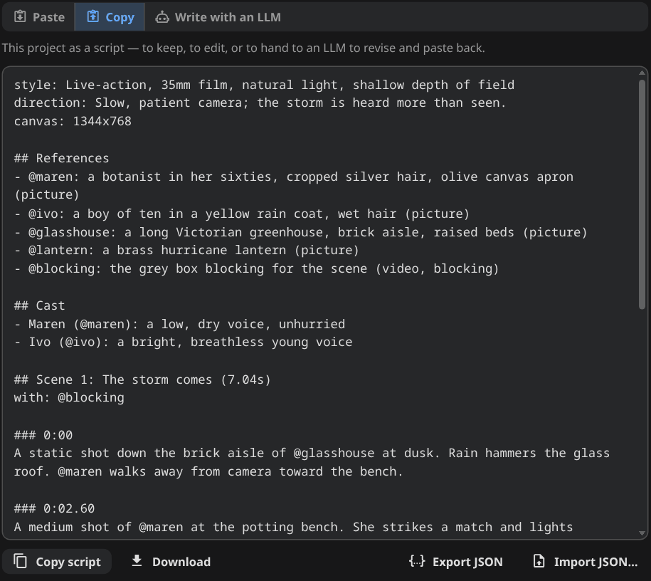
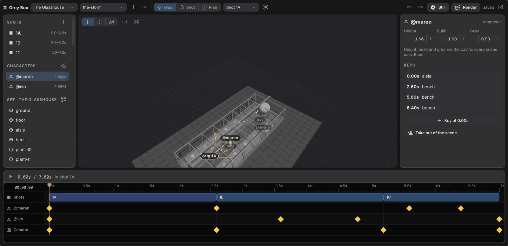
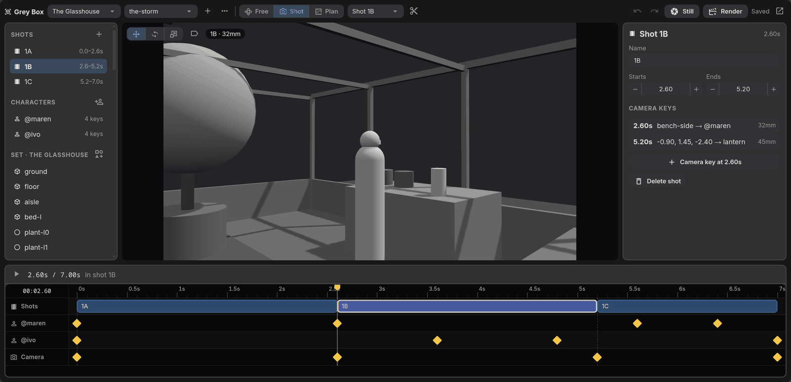
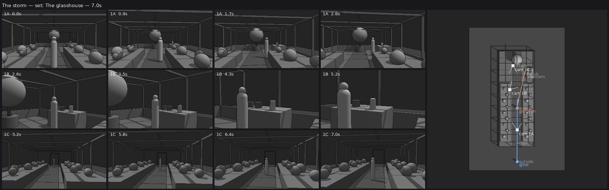
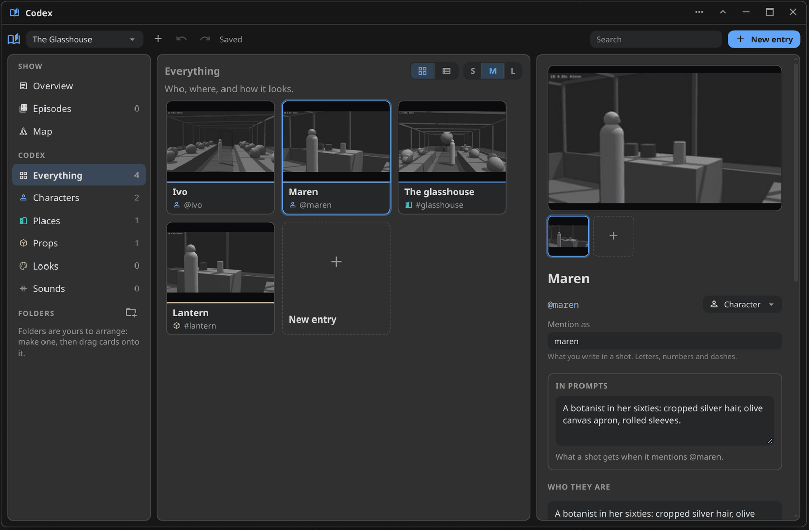
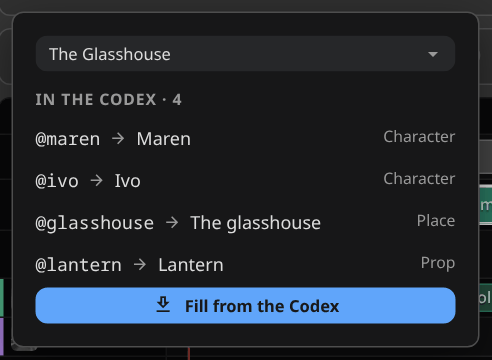

# Nynxz H3 Studio

A production pack for [MiniMax H3](https://github.com/MiniMax-AI/MiniMax-H3) in ComfyUI. Write a
film as scenes and shots, block it in 3D, keep its characters and places in one place, and render
the whole thing in a single queue.



| | |
|---|---|
| **[H3 Studio](#h3-studio)** | A film on a timeline: scenes, shots, dialogue, references and keyframes, compiled into H3's prompt format and rendered a scene at a time |
| **[Grey Box Studio](#grey-box-studio)** | Simple 3D blocking — a set of plain shapes, characters moving between marks, a camera per shot — rendered as grey video H3 can follow |
| **[The Codex](#the-codex)** | A show's characters, places, props and looks, with their pictures, prompts, voices and LoRAs, filled into any film by name |
| **[Building blocks](docs/NODES.md)** | The H3 nodes underneath: references on one wire, conditioning, prompt rewriting, faster sampling, partial decoding |

## H3 Studio

One node holds the film. H3 generates about 5–15 s at a time, so a **scene** is one generation
and its **shots** are the beats inside it — moving a cut on the timeline edits the prompt. Write
`@maren` in a shot and the studio turns it into the right `<Subject>`, `<Picture>` or `<Video>`
tag; give a line to a character and it becomes dialogue in their voice.



- **References** — pictures, videos and audio, each shown in the scenes that mention it. A
  picture can give H3 its look or only its meaning; a video can be a full reference or just
  **blocking** (staging, timing and camera, none of its look).
- **Keyframes** pin the first frame, the last frame, or a moment in between.
- **Continuations** carry a scene's last frames and sound into the next, so cuts can flow.
- **Direction** — a film-wide line (*"slow, patient camera"*, *"animate on twos"*) with a
  per-scene override.
- **Render** the whole film, one scene, or only what's out of date. Each scene keeps its seed,
  and a scene whose prompt, media and models haven't changed plays its saved clip instead of
  sampling again.

The whole project round-trips as a plain-text script, for keeping, editing, or handing to an LLM
to revise and paste back:



More in [docs/H3-STUDIO.md](docs/H3-STUDIO.md).

## Grey Box Studio

Block a scene before spending a render on it. A set is plain boxes, cylinders and spheres; the
cast are labelled figures that walk between marks; each shot has a camera with keys. Everything is
JSON that people and agents can both write.



Look through a shot's camera to frame it, then render the scene as it cuts. The grey video goes
into H3 Studio as a `blocking` reference, so the layout and the camera move stay put instead of
being reinvented each take.

 

More in [docs/GREYBOX.md](docs/GREYBOX.md), including the command-line loop and the agent tools.

## The Codex

The show's bible: every character, place, prop, look and sound once, with pictures, the line a
prompt gets when it's mentioned, a voice, and LoRAs. Each Codex show is also a Grey Box project.



In H3 Studio, the References tab's **Codex** button matches `@names` to entries and fills them in;
placeholders the show doesn't have yet can be added to it. Give a character a new picture in the
Codex and the next fill brings it to every film.



The pictures in these screenshots are grey box stills standing in for real references.

## Install

Clone into `ComfyUI/custom_nodes`, then build the editors (Vue, built into `web/`):

```bash
cd ComfyUI/custom_nodes
git clone https://github.com/Nynxz/ComfyUI-NynxzH3Studio
cd ComfyUI-NynxzH3Studio
pnpm install && pnpm build
```

Restart ComfyUI. You need:

- **ComfyUI 0.30.0 or newer** (the first with MiniMax H3) and the H3 models.
- **[ZenKit](https://github.com/Nynxz/ZenKit)** (optional) — the studios pop out into windows and
  the Codex opens from its Start menu. Without it the Codex is a sidebar tab.
- **[ComfyUI-NynxzNodes](https://github.com/Nynxz/ComfyUI-NynxzNodes)** (optional) — H3 Studio's
  LoRA lanes use its LoRA browser.

Node ids are the ones these nodes had in NynxzNodes and NynxzH3, so saved workflows load
unchanged.

## Rendering a film

The studio renders the scene under the playhead:

    H3 Studio Setup ──▶ H3 Studio ──▶ H3 Studio Outputs ──▶ sampler ──▶ decode ──▶ H3 Studio Clip

To render every scene in one queue, put that chain in core's **Start Loop / End Loop**, with
**H3 Studio Scenes** feeding the loop and **H3 Studio Join** assembling the clips into the film.
The wiring is in [docs/H3-STUDIO.md](docs/H3-STUDIO.md#rendering-the-whole-film-in-a-loop).

## Writing with an agent

[`skills/h3-studio`](skills/h3-studio/SKILL.md) teaches an agent the script format: scenes,
timings, `@references`, dialogue, blocking and direction. Its scripts paste straight into the
studio. Grey Box and the Codex expose their actions as tools to
[ZenAgent](https://github.com/Nynxz/ZenKit).

## Nodes

| Menu | Nodes |
|---|---|
| `Nynxz/H3/Studio` | H3 Studio, Setup, Outputs, Scenes, Clip, Join |
| `Nynxz/H3/Grey box` | Grey Box Studio, Grey Box Shot |
| `Nynxz/H3/References` | H3 Reference, H3 Mood Board, H3 Reference to Video |
| `Nynxz/H3/Conditioning` | H3 Canvas, Inputs, Image, Video, Audio, Encode, Extras |
| `Nynxz/H3/Prompt` | H3 Rewrite Prompt, Rewrite Clean, CLIP LoRA, Edit (experimental) |
| `Nynxz/H3/Sampling` | H3 Block Cache, Depth Skip, Detail Schedule, Row Chunk, Scheduled Sampler, Sliding Window, Reference Isolate |
| `Nynxz/H3/Latent` | H3 Decode Frames, Latent Slice |

Each building block is described in [docs/NODES.md](docs/NODES.md); the reasoning and
measurements behind the sampling nodes are in [docs/sampling-notes.md](docs/sampling-notes.md).

## Development

```
__init__.py       the NODES list
nodes/            Python: h3studio/, greybox/, references/ and the building blocks
frontend/         the editors (Vue + ZenKit), built into web/ by `pnpm build`
docs/             how each part works, and why
skills/           the agent skill for writing scripts
```

```bash
pnpm build        # after changing frontend/
pnpm check        # lint, types, format, ruff, build
```

Python changes need a ComfyUI restart; frontend changes need a build and a page reload.

## License

MIT
