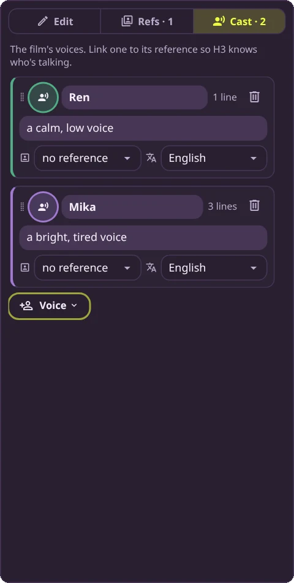
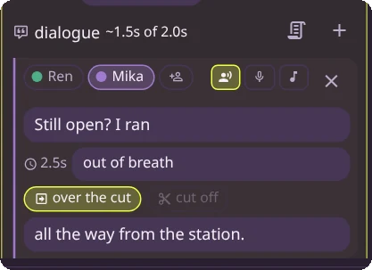
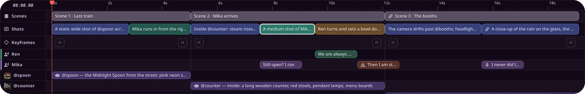

# Dialogue and voices

H3 makes the sound along with the picture, speech included. Give a shot some lines and H3 says
them in the clip, in the voice you describe, at roughly the moment you put them.

Two places matter:

- **The Cast tab** holds the voices: who can speak, and what they sound like.
- **Each shot** holds its lines: who says what, and how.

## The cast



Open the **Cast** tab in the sidebar. Each card is one voice:

- **Name.** How you refer to them. A line's speakers are picked by name.
- **Sounds like.** A short description of the voice: *a calm, low voice*, *a bright, tired
  voice*. It goes into the prompt the first time the voice is heard in a scene.
- **Reference.** The picture or video reference this voice belongs to. Linking Ren's voice to
  `@ren` tells H3 his lines come from that person on screen; without it, he's only a name. Leave it
  on *no reference* for someone who's only heard.
- **Language.** The language the words are in. It's written next to every line so H3 doesn't
  guess.
- **Timbre** (only when the film has an audio reference). An audio clip whose voice this one
  should follow.

**+ Voice** adds one. When there are references without a voice, it opens a menu: a new voice,
or one already linked to a reference (blocking videos and audio are left out). Drag a card by its
grip to reorder; the timeline's voice lanes follow the same order.

Voices belong to the whole film, so Mika sounds the same in every scene.

<br clear="right">

## Writing lines

Select a shot and scroll to **dialogue** under its text.



From the top:

- **~1.5s of 2.0s.** About how long the shot's lines take to say, against the shot's length.
  It turns red when the talking runs past the cut.
- **The script button** opens a box for pasting several lines at once (see
  [Pasting a script](#pasting-a-script)). **+** adds a line.
- **Ren · Mika.** Who speaks. Click a name to give them the line; **Shift+click** to add a
  second speaker, so they say it together. The person-plus button makes a new voice.
- **The three icons** are how the line is heard: **says** (spoken on screen), **voice-over**
  (heard off screen, with the speaker's lips closed), or **sings**.
- **The words.** Exactly what's said. They go into the prompt word for word, so write them the
  way they should sound.
- **2.5s.** When the line starts, in seconds into the scene.
- **How.** The delivery: *softly*, *out of breath*, *with a laugh*. Pick one from the list or
  type your own.
- **over the cut** carries the line into the next shot. A second box appears for the part heard
  after the cut.
- **cut off** ends the line abruptly at the end of the clip. It's only available on a scene's
  last shot.

Keyboard: **Enter** in a line starts the next one, for whoever spoke before the line you just
wrote (so a back-and-forth flows); **Backspace** on an empty line removes it; **Alt+Enter** adds a
line from anywhere in the shot.

## Timing

Lines follow straight on from each other, starting when the shot starts. The studio estimates how
long each one takes: about 2.6 words a second in English, 4.5 characters a second in Chinese,
Japanese or Korean, and slower when sung. These are estimates. H3 decides the real pace, so leave
some room.

Every voice has a lane on the timeline, under the shots:



- **Drag a line** along its lane to move it. Dropped in a gap, it's said at that moment. Dropped
  on another line, it goes before that line (front half) or straight after it (back half). A placed line shows its time with an **×** in the editor;
  click the **×** to let it follow straight on again.
- A gap of more than 0.8 seconds before a line is written into the prompt as a pause.
- A **⚠** on a line means it probably runs past the end of its shot. A **microphone** marks a
  voice-over.

## Pasting a script

The script button reads a screenplay. Pasting two or more `NAME: words` lines into the dialogue
(anywhere but a text box) does the same:

```
MIKA (out of breath): Still open?
REN (warmly): We are always open.
MIKA (V.O.): I never did leave.
REN & MIKA: Cheers.
@mika (sings): La la la.
```

- A name is a voice in the cast, a reference's `@name`, or a new voice. Names in capitals
  (`MIKA`) match the voice `Mika`.
- In brackets: `(V.O.)` or `(O.S.)` makes a voice-over, `(sings)` a sung line, and anything else
  is how it's said.
- `&` makes several people speak together.
- A line of text without a `NAME:` joins the line before it.

The film's whole script (**Script** in the toolbar) uses the same form for dialogue, plus `>>`
for the part of a line heard over the next cut and a trailing `--` for a line that's cut off.

## What H3 is told

You don't have to write any of this; it's useful when a line doesn't come out the way you
expected. Scene 2 of the example compiles to:

```
[Shot 2] At 00:02.500, a medium shot of Mika shaking off her coat and taking the middle stool.
Mika (S1) says out of breath in a bright, tired voice: <d>[English] Still open? I ran <scenetrans></d>
The line continues seamlessly across the cut.
[Shot 3] At 00:04.500, Ren turns and sets a bowl down in front of her without a word, then smiles.
The voice of Mika (S1) carries over from the previous shot: <d>[English] <scenetrans> all the way
from the station.</d> Ren (S2) says warmly in a calm, low voice: <d>[English] We are always open.</d>
Mika (S1) says: <d>[English] Then I am staying.</d>
```

- Each speaker gets an id, **S1**, **S2**…, in the order they're first heard in the scene, and
  keeps it for the whole scene. A voice's description is only given the first time.
- The words sit inside `<d>…</d>` with their language. Everything about who and how stays
  outside, so it's never spoken.
- A voice linked to a reference is named by its subject tag (`<Subject 2>`) instead of the
  voice's name, when the scene has references.
- `<scenetrans>` marks where a line crosses a cut, and `<cutoff>` a line cut short.

## Tips

- **Keep the talking shorter than the shot.** If the length turns red, split the line across
  the cut with **over the cut**, make the shot longer, or say less.
- **Describe the voice once, in the cast,** not in every line. Use **How** for what changes from
  line to line.
- **Link speaking characters to their references.** H3 then knows whose mouth moves, which helps
  most when two people share a shot.
- **Use voice-over for thoughts and narration.** The speaker's lips stay closed even when
  they're on screen.
