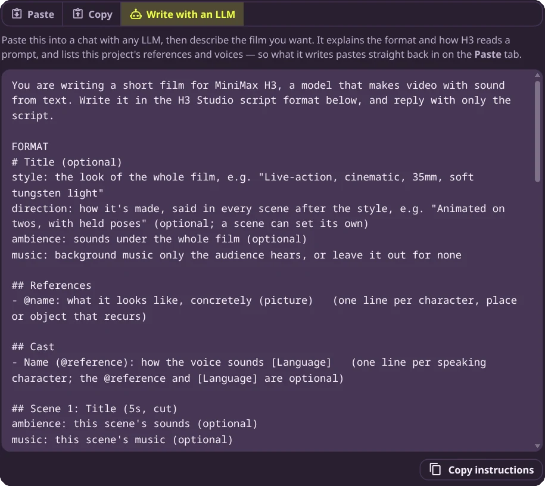
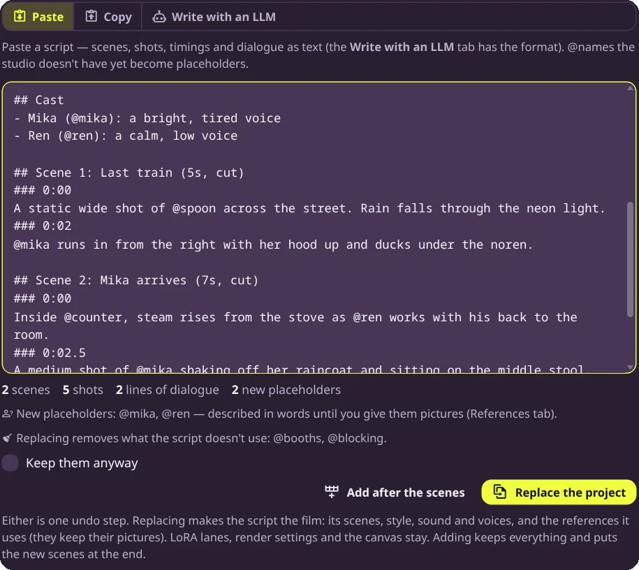

# Writing scripts with an LLM

A whole film can be written as plain text: scenes, shots, timings, dialogue and references. The
studio reads it in one go. That makes it easy to have an LLM draft a film, or revise one, and
paste the result back in.

There are two ways to teach an LLM the format:

- **Any chat.** The Script dialog's **Write with an LLM** tab gives you instructions to paste
  into any chat (ChatGPT, Claude, a local model…). They include this project's references and
  voices, so what comes back fits the film you already have.
- **An agent with skills.** The pack ships a skill,
  [`skills/h3-studio`](https://github.com/Nynxz/ComfyUI-NynxzH3Studio/tree/main/skills/h3-studio),
  for agents that load skills, such as Claude Code. It has the full format, a worked example, how
  to write for H3, and a checklist the agent runs before handing the script over.

## From a chat

Open **Script** in the studio's toolbar and go to **Write with an LLM**.



1. **Copy instructions** and paste them into a new chat.
2. Describe the film: what happens, how long, how it should look. A paragraph is enough.
3. Copy the script it writes, go back to **Paste**, and paste it in.

## With the skill

Copy the `skills/h3-studio` folder into your agent's skills folder (for Claude Code,
`~/.claude/skills/`), then ask for a film in plain words: *"Write a 30-second H3 Studio script:
Mika runs into the Midnight Spoon to get out of the rain."* The agent plans the scenes, declares
the references and cast, writes the shots and dialogue, checks its own work, and lists the
placeholders you'll want to give pictures to.

The skill knows about the rest of the pack too. It names references after your Codex entries, so
**Fill from Codex** can fill them in later, and it uses Grey Box renders as **blocking** videos when you
say you have them.

## Pasting it in



Under the text the studio says what it read (scenes, shots, lines of dialogue, new placeholders)
and anything wrong with it, such as a shot that starts after its scene ends. Fix those before
going on. Then choose:

- **Replace the project.** The script becomes the film: its scenes, style, sound and voices,
  and the references it uses. References keep their pictures. LoRA lanes, render settings and the
  canvas size stay. References the script doesn't use are removed, unless you tick **Keep them
  anyway**.
- **Add after the scenes.** Everything stays, and the script's scenes go on the end.

Either way it's one undo step.

New `@names` arrive as **placeholders**: references with a description but no picture yet. Until
you give one a picture in the References tab, H3 reads the description wherever the name is used.

## Revising a film

1. **Script → Copy** gives you the film as it is now, in the same format.
2. Paste that into the chat (or give it to the agent) and say what to change: *"make scene 2
   longer and give Ren a second line"*.
3. Paste the answer back with **Replace the project**. References with the same names keep their
   pictures.

A script can't hold keyframes or per-scene LoRA strengths. Those belong to the scenes they were
set on, so a replaced scene loses them. Add them again after pasting.

## An example

The opening of the Midnight Spoon, as a script:

```
# Midnight Spoon — Last orders
style: 1990s cel anime, hand-painted backgrounds, rain-soaked neon at night
direction: animated on twos, mostly locked-off framing
ambience: steady rain, a neon sign humming

## References
- @spoon: a narrow ramen shop on a wet street at night, a pink neon sign reading "Midnight Spoon", a red paper lantern, a blue noren over the door
- @counter: the inside of the shop, a long wooden counter with red stools, pendant lamps and handwritten menu boards
- @mika: a young woman with short black hair, a soaked yellow raincoat and a canvas backpack
- @ren: a tall cook in his twenties, a white headband, a dark apron and rolled sleeves

## Cast
- Mika (@mika): a bright, tired voice
- Ren (@ren): a calm, low voice

## Scene 1: Last train (5s, cut)
### 0:00
A static wide shot of @spoon across the street. Rain falls through the neon light.
### 0:02
@mika runs in from the right with her hood up and ducks under the noren.

## Scene 2: Mika arrives (7s, cut)
### 0:00
Inside @counter, steam rises from the stove as @ren works with his back to the room.
### 0:02.5
A medium shot of @mika shaking off her raincoat and sitting on the middle stool.
MIKA (out of breath): Still open? I ran >> all the way from the station.
### 0:04.5
@ren turns and sets a bowl in front of her, then smiles.
REN (warmly): We are always open.
```

A few things to notice:

- Each reference is described as one concrete noun phrase. The description stands in for the
  picture until there is one.
- `### 0:02.5` starts a shot two and a half seconds into its scene; `### 2:00` would be two
  minutes. Every new shot is a cut.
- `MIKA (out of breath): …` is dialogue, and `>>` sends the rest of the line over the next cut.
  See [Dialogue and voices](Dialogue-and-Voices.md) for everything a line can do.

The full format, every heading and option, is in the skill's
[script-format reference](https://github.com/Nynxz/ComfyUI-NynxzH3Studio/blob/main/skills/h3-studio/references/script-format.md).
